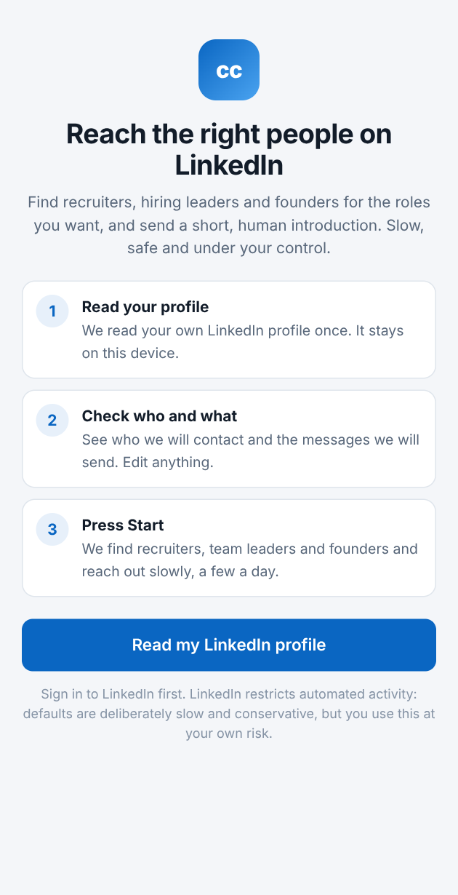
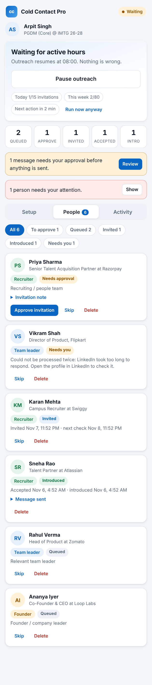
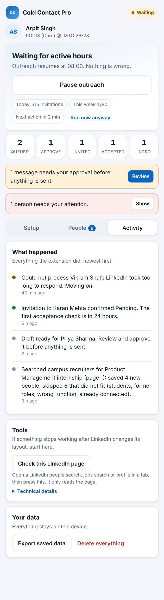
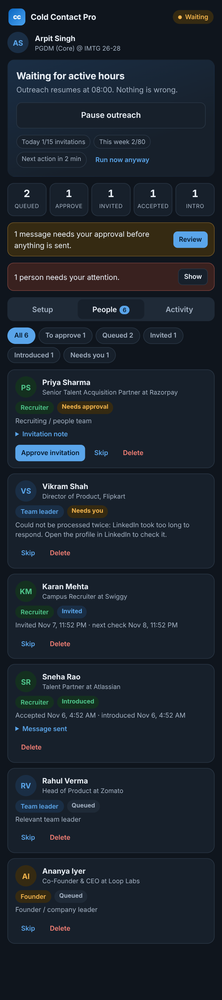

<div align="center">


# Referral Scout

**Find jobs. Get referred.**

A browser extension that searches LinkedIn jobs for the role you want, lets you choose the companies, then finds the people at each one whose referral counts and asks them politely, a few a day.

<sub>Chrome &amp; Edge (Manifest V3) · v0.22.0 · No servers, no API keys, no telemetry</sub>

</div>

<br />

<p align="center">
  
  &nbsp;&nbsp;
  
</p>

---

## The problem

Most jobs and internships are never won through the "Apply" button. They are won by getting a short note in front of the person who actually decides: a recruiter, the team lead, or the founder.

Doing that well is tedious. You search, scan dozens of headlines, work out who is worth writing to, personalise each note, keep track of who replied, and remember to follow up. Most people give up after a handful, or fall back on copy-pasting the same message to everyone.

The tools that promise to fix this tend to go the other way: fast, bulk, and risky for your account.

## What Referral Scout does

It does the searching, filtering, drafting and tracking, and leaves the decisions to you.

| | |
|---|---|
| **Finds the right people** | Searches LinkedIn for recruiters, team leaders and founders that match the roles you list. |
| **Filters out the wrong ones** | Skips students, "open to work" profiles, former roles, assistants, and anyone you already know. |
| **Writes like you** | Fills your own template per person. Optionally lets ChatGPT lightly adapt it. |
| **Pays attention to timing** | Checks every 2 hours who accepted, then sends one follow-up. Never two. |
| **Stays under the radar** | 15 invitations a day, 80 a week, quiet hours, 30-second gaps between sends. |
| **Keeps you in control** | Every send waits for your **Approve** by default. |

## Who it is for

- **Students and early-career job seekers** chasing internships and first roles, especially where applications go into a void and a direct note to a campus recruiter or hiring manager matters.
- **Career switchers** who need to be introduced to teams in a new function.
- **Anyone doing a focused job search** who would rather send 15 good notes a day than 150 bad ones.

It is **not** built for sales prospecting, lead-gen at scale, or mass messaging. The limits are deliberately set to prevent that.

## How it works

```
 Read your profile  →  Check who + what we send  →  Start outreach
        │                      │                          │
   once, stays on         edit anything              runs in the background,
   this device                                       a few people a day
```

1. **Read** · Open LinkedIn, open the side panel, press **Read my LinkedIn profile**. The extension reads *your own* profile once, to suggest a target role and fill in your name.
2. **Check** · Review **Who to contact** and **Your messages**. Both are plain, editable templates.
3. **Start** · Press **Start outreach**. From here:

| Stage | What happens |
|---|---|
| **Find** | LinkedIn people search by role and location, filtered by connection degree. At most 3 people per company so no one company gets a pile of requests. |
| **Invite** | 2nd and 3rd+ degree people get a connection request with your note (200-character limit). When your free monthly notes run out, requests go out without one. |
| **Message** | 1st-degree matches, and anyone who accepts, get a single message. |
| **Track** | Your connections list is read every 2 hours to see who accepted. Requests unanswered for 3+ weeks are flagged so you can withdraw them. |

Pages open in a separate window that is never brought to the front, so your own browsing is not interrupted.

## Who it chooses to contact

The targeting logic is deliberately opinionated. It reads each search result's headline and sorts people into three groups, then ranks them.

| Group | Examples it recognises | Why |
|---|---|---|
| **Recruiter** *(ranked highest)* | Talent Acquisition, Campus / University Recruiter, Early Careers, HR Business Partner, Head of People | They own hiring. Campus and early-careers roles rank first for internship searches. |
| **Team leader** | Head, Director, VP, Manager in *your* function (e.g. "Director of Product" for a PM search) | They decide who joins their team. |
| **Founder** | Founder, Co-founder, CEO, Managing Director | In smaller companies they are the hiring manager. |

It **skips** people who are:

- 1st-degree connections (nothing to invite)
- Students, interns, trainees, or marked *open to work*
- Former role-holders ("Ex-Google Recruiter", "Former CEO")
- Assistants and chiefs of staff ("Founder's Office", "Executive Assistant")

Ranking gets a boost for 2nd-degree connections, company matches and location fit, and a penalty for location mismatches. Closing lines in the first note also change by group: recruiters are asked about openings, founders about what they are building.

## Built to protect your account

LinkedIn restricts automated activity. The defaults assume that, and they are the product, not a footnote.

| Safeguard | Default |
|---|---|
| Review before every send | **On.** Approve one at a time or **Approve all**. |
| Invitations per day | **15** |
| Invitations per week | **80** |
| Pending requests at once | **100** |
| Gap between sends | **~30 seconds** (adjustable from 5 s) |
| Active hours | **8:00 to 22:00** local time |
| People per company | **3** |
| Auto-pause | Signed out, security check, LinkedIn's weekly limit, or 3 failed sends in a row |
| Uncertain send | **Never retried blindly.** It is flagged for you to check. |

The extension does not read cookies, passwords or tokens, does not call private LinkedIn endpoints, and does not try to get around challenges, warnings or restrictions. It drives the same pages you see, using the same buttons you would click.

> **Use at your own risk.** LinkedIn's terms restrict automation. Conservative defaults lower the risk; they cannot remove it.

## Your messages, your voice

- **Templates first.** Placeholders: `{firstName}` `{myFirstName}` `{target}` `{company}`. Write several versions separated by `---` and each person gets one.
- **Live preview.** See the exact text for a sample person, with the 200-character counter, before anything is sent.
- **ChatGPT is optional.** If you turn it on, the extension uses your already signed-in chatgpt.com tab to lightly adapt your template per person. No API key. If ChatGPT is signed out or fails, you are told and your template is used.
- **Edit anything.** Drafts can be edited by hand, rewritten by ChatGPT, or reset to your template.

## A calm side panel

- A **status card** that always says what is happening: *Running, Waiting for active hours, Paused, Needs you.*
- **Setup**, **People** and **Activity** views, plus a full log of every action.
- **Remember** button at the bottom-left of LinkedIn profile and job pages. Click it, write a note (for example "hiring APM interns, message once they accept"), and press Save. Saved people and jobs, with reminders and application progress, live in the side panel.
- Light and dark themes.

<p align="center">
  
  &nbsp;&nbsp;
  
</p>

## Privacy

- Everything is stored **locally** in the extension's own database. There is no Referral Scout server, analytics, or account.
- No OpenAI API key, no private LinkedIn endpoints, no credential access.
- If you enable ChatGPT, the text needed to write each note (your profile text, plus the recipient's visible name, headline and company) is typed into a visible ChatGPT prompt through your own signed-in session. ChatGPT may retain it under your account settings.
- You can pause, export, or delete your data from the side panel. Deleting does not recall messages already sent.

Full details: [`docs/privacy.md`](docs/privacy.md)

## Install

You will need **Node.js 22+** and a Chromium browser (Chrome 120+ or Edge).

```bash
corepack enable
corepack pnpm install --frozen-lockfile
corepack pnpm build
```

Then load it:

1. Open `chrome://extensions` (or `edge://extensions`) and turn on **Developer mode**.
2. Choose **Load unpacked** and select the generated **`dist/`** folder.
3. Pin the extension, open LinkedIn while signed in, and click the icon to open the side panel.

After rebuilding, reload the extension and refresh any open LinkedIn and ChatGPT tabs.

To try every screen with sample data and no LinkedIn access:

```bash
node scripts/preview-network.mjs
# open http://127.0.0.1:4173/?screen=active   (also: welcome, ready, review, attention, quiet)
```

## Project status

**Early release (v0.15.x).** Reading LinkedIn works and has been checked against the live site. Sending has not yet been proven end to end, so treat the first real sends as a supervised test.

| Area | Status |
|---|---|
| Read your profile, detect signed-in account | Verified live |
| People search, degree filter, pagination | Verified live |
| Reading a person's connection state, Connect / Message / More | Verified live |
| Typing into the message box (without sending) | Verified live |
| Reading your connections list for acceptances | Verified live |
| Remember button and note box on profile and job pages | Tested on a saved real LinkedIn profile page (with an ad blocker active); **not yet confirmed in a live browser** |
| Invitation dialog, adding a note, real send | **Not yet verified live** |
| "Pending" confirmation after an invitation | **Not yet verified live** |
| Message send confirmation | **Not yet verified live** |
| ChatGPT personalisation while signed in | **Not yet verified live** |

The exact record is in [`docs/live-verification.md`](docs/live-verification.md). Release history is in [`CHANGELOG.md`](CHANGELOG.md).

## Troubleshooting

| Symptom | What to do |
|---|---|
| **No results or slow discovery** | Check your roles and location. Open a LinkedIn people search and press **Check this LinkedIn page** in the side panel. |
| **ChatGPT tab opens but no prompt appears** | Confirm you are signed in and no draft, login page, challenge or usage cap is showing. Then open **Automation diagnostics** in the side panel. |
| **LinkedIn blocked an action** | Check the exact profile in LinkedIn. The extension will not bypass restrictions. |
| **A send is marked uncertain** | Look at the person on LinkedIn and at their activity record. It will not be retried automatically. |
| **No acceptance checks while the browser is closed** | Chrome and Edge cannot run extension timers when fully closed. Overdue checks run on the next start. |

## Under the hood

TypeScript, Vite, Zod and Vitest. Manifest V3 with a service worker, content scripts and a side panel. Pure, unit-tested targeting rules (`src/shared/targeting.ts`), readers that find things by role, label and text rather than LinkedIn's generated class names, and an idempotent action ledger so nothing is sent twice.

```bash
corepack pnpm check     # tests + typecheck + build, same as CI
```

Contributions are welcome. Start with [`CONTRIBUTING.md`](CONTRIBUTING.md). Security reports: [`SECURITY.md`](SECURITY.md).

## License

No open-source license has been selected yet; all rights reserved. Discuss before reusing or redistributing the code.

---

<sub>Referral Scout is an independent project. It is not affiliated with, endorsed by, or sponsored by LinkedIn or OpenAI.</sub>
