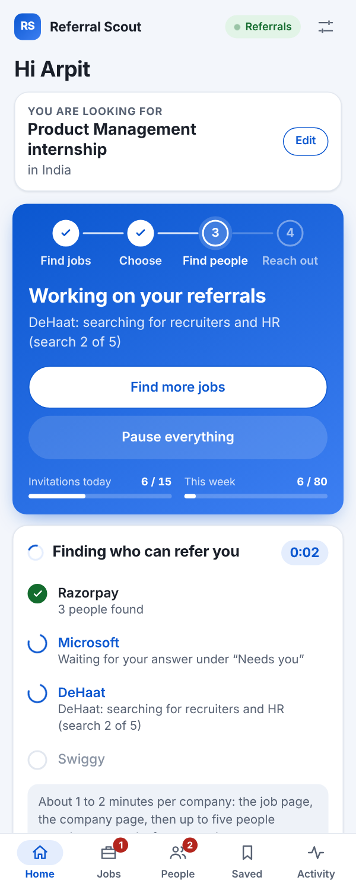
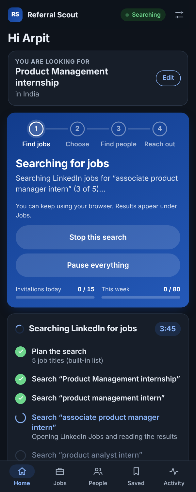
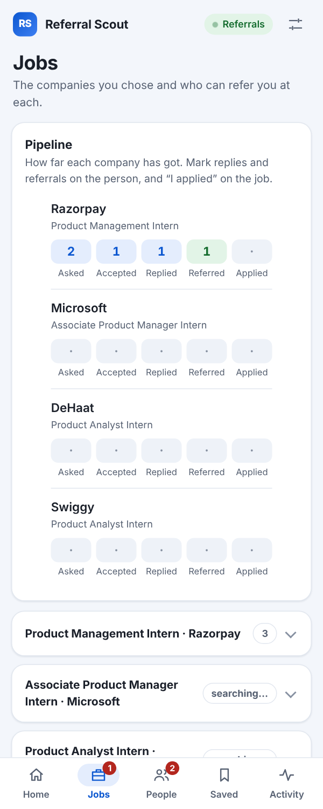

<div align="center">


# Referral Scout

**Find jobs. Get referred.**

A browser extension that searches LinkedIn jobs for the role you want, lets you choose the companies, then finds the people at each one whose referral counts and asks them politely, a few a day.

<sub>Chrome &amp; Edge (Manifest V3) · v0.31.0 · No servers, no telemetry, API key optional</sub>

</div>

<br />

<p align="center">
  
  &nbsp;&nbsp;
  
  &nbsp;&nbsp;
  
</p>

## The problem

A referral is the most reliable way into an interview, and asking for one is slow, repetitive work: find the openings, work out who at each company could refer you, write to each of them, and remember who answered. Most people give up after two or three companies.

## What Referral Scout does

It runs that routine from a side panel in your browser, on your own signed-in LinkedIn, in four steps:

1. **Find jobs.** It searches LinkedIn Jobs for the role you typed and for similar titles (an "operations intern" search also tries supply chain, logistics and business operations).
2. **You choose the companies.** It keeps one job per company, ranks companies where you already know someone higher, removes adverts and poor matches, and shows you the list. Nothing is contacted until you confirm.
3. **Find the right people.** At each company it uses LinkedIn's *Current company* filter to find people whose referral counts and who are likely to answer.
4. **Reach out, slowly.** People you already know get a message. The strongest three to five others get a connection request with a short note, and a follow-up once they accept.

You can also start from any LinkedIn job page: the extension adds **Ask for referrals** and **My connections here** buttons there.

## Who it asks

The right person depends on the company, so that judgement is made per company:

| Company | Asked | Not asked as a stranger |
|---|---|---|
| Large (Microsoft, Infosys) | Campus recruiters, HR partners, managers and team leads in the job's function | CEO, CFO, VPs, directors |
| Mid-size or scale-up | Talent partners, function managers, head of the function | Founders, unless the company is clearly small |
| Startup | Founder, head of the function, chief of staff, any HR or talent person | |

Recruiters and HR are asked at every company. Interns, students, former employees and "open to work" profiles are never asked.

## Where ChatGPT comes in

ChatGPT is used for three questions per run, each covering everything at once: which job titles to search, which listings to drop, and who to ask at each chosen company (with the wording for the note and messages). The extension checks every answer before using it, and carries on with built-in rules whenever ChatGPT is unavailable.

There are two ways to connect it:

- **The ChatGPT website (default).** Nothing to set up; stay signed in at chatgpt.com. Questions are typed into a background tab and the answer is read back.
- **Your own OpenAI API key (optional).** Faster, and no tab is opened. Set it under Settings, ChatGPT connection. OpenAI bills API use to your account.

## Tracking what came of it

Home shows the whole pipeline in six numbers: **Companies, Asked, Accepted, Replied, Referred, Applied**. Jobs shows the same per company. Invitations and acceptances are tracked for you. Replies, referrals and applications are marked by you with one press, because the extension does not read your LinkedIn inbox.

## Built to protect your account

LinkedIn's User Agreement does not allow automated activity, and accounts that send too much get restricted. The defaults are deliberately slow, and **you use this at your own risk**.

| Setting | Default |
|---|---|
| Invitations | 30 a day, 80 a week |
| Pending invitations | Stops at 100 outstanding |
| Pause between sends | 30 seconds or more, never a fixed rhythm |
| People per company | 3 (you can choose 4 or 5) |
| Companies per search | 10 ticked for you, up to 20, confirmed by you |
| Hours | Any time; an "only 08:00 to 22:00" option is in Settings |

**Pause everything** stops searches and sending at once, and **Resume** continues exactly what was running. A LinkedIn sign-out or checkpoint pauses everything with the reason. All background work happens in one separate window that is never brought to the front and closes when the work is done.

## Privacy

- Everything is stored in your browser, on your device. There is no server and no telemetry.
- Text sent to ChatGPT: your target roles, your headline or CV text if you added one, and the job titles and company names being planned. Nobody's profile is sent for the planning questions.
- An API key, if you add one, is stored on your device only, is never shown again in the panel, and is left out of exports.
- **Settings → Export saved data** downloads everything as a file; **Delete everything** removes it.

More detail: [`docs/privacy.md`](docs/privacy.md).

## Install

You will need **Node.js 22+** and a Chromium browser (Chrome 120+ or Edge).

```bash
corepack enable
corepack pnpm install --frozen-lockfile
corepack pnpm build
```

Then load it:

1. Open `chrome://extensions` (or `edge://extensions`) and turn on **Developer mode**.
2. Choose **Load unpacked** and select the generated **`dist/`** folder.
3. Pin the extension, open LinkedIn while signed in, and click the icon to open the side panel.

Setup is two steps: read your LinkedIn profile, then say what role you want and where. After rebuilding, reload the extension and refresh any open LinkedIn and ChatGPT tabs.

## Project status

Working, and still young. What is and is not confirmed on the live sites is recorded in [`docs/live-verification.md`](docs/live-verification.md), and every change is in [`CHANGELOG.md`](CHANGELOG.md).

- LinkedIn changes its pages often. When something stops being read, **Settings → Check this LinkedIn page** says which part.
- Location filtering is confirmed for India; other countries and cities fall back to a text match.
- The API key path and the detection of LinkedIn's "Promoted" listings have automated tests but have not been confirmed live.

## Troubleshooting

| What you see | What to do |
|---|---|
| "ChatGPT was not available" | Sign in at chatgpt.com in the same browser, or add an API key. The run continues on built-in rules either way. |
| Nothing happens after Resume | Open Activity: the newest line says what is being waited for. |
| A company shows "closed early" | LinkedIn pages for it could not be read. Remove the job and add it again from its job page. |
| The Remember or referral buttons are missing on LinkedIn | Refresh the LinkedIn tab after installing or updating. |

## Under the hood

TypeScript, Vite, Zod and Vitest. Manifest V3 with a service worker, content scripts and a side panel.

| Folder | What lives there |
|---|---|
| `src/shared` | Pure rules with no browser access: who to ask, how jobs are ranked, the ChatGPT prompts and how their answers are checked |
| `src/background` | The engine (one step at a time), the handlers behind the panel's buttons, tab and window handling, the ChatGPT and API connection |
| `src/content`, `src/parsers` | Reading LinkedIn and ChatGPT pages by role, label and text, never by generated class names |
| `src/ui` | The side panel: `core` (helpers), `live` (status and tracker), `jobs`, `people`, `pipeline`, `setup`, `activity`, `sidepanel` (the screen itself) |

```bash
corepack pnpm check     # formatting, tests, typecheck and build, same as CI
corepack pnpm format    # reformat with Prettier
```

Contributions are welcome. Start with [`CONTRIBUTING.md`](CONTRIBUTING.md). Security reports: [`SECURITY.md`](SECURITY.md).

## License

No open-source license has been selected yet; all rights reserved. Discuss before reusing or redistributing the code.

---

<sub>Referral Scout is an independent project. It is not affiliated with, endorsed by, or sponsored by LinkedIn or OpenAI.</sub>
