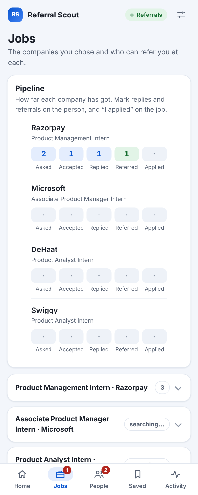
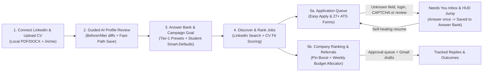
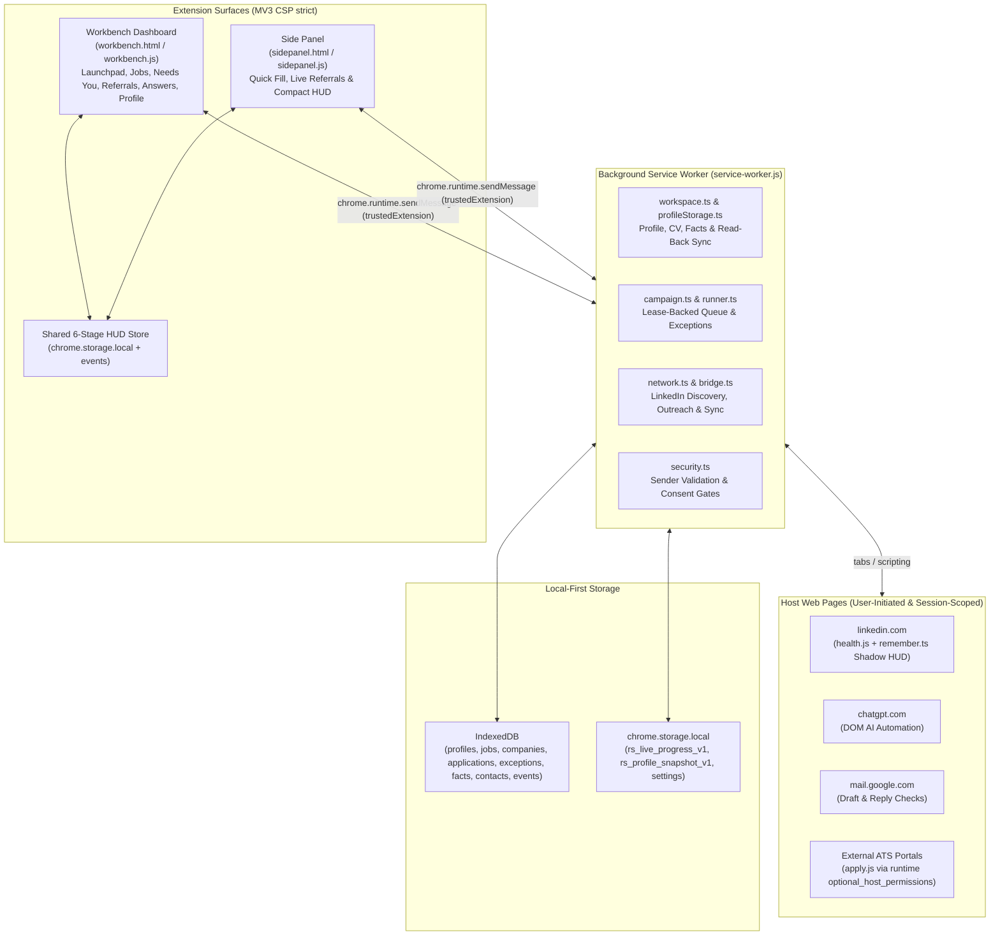

<div align="center">


# Referral Scout

**Find jobs that match your CV, prioritize target companies, line up referrers, and autofill applications—always under your review.**

[](#architecture)
[](#for-developers)
[](#verification--packaging)

**[Install on Microsoft Edge Add-ons](https://microsoftedge.microsoft.com/addons/detail/referral-scout-jobs-and-/lhfibhgokebhefdagadklckepkbbljhc)** · **[Privacy Policy](docs/privacy.md)** · **[Store Submission Packet](docs/store-submission.md)** · **[Architecture](docs/architecture-v2.md)**

</div>

<p align="center">
  
  &nbsp;
  
  &nbsp;
  
</p>

---

## Core Capabilities

- **Guided CV & LinkedIn Review (`src/ui/workbench/components/guided-review.ts`):** Upload a PDF or DOCX CV and read your signed-in LinkedIn profile locally. ChatGPT compares both (giving CV priority on conflicts), highlights Before/After differences, and commits verified fields atomically into your Candidate Profile and Answer Bank only after you click **Accept & Apply**.
- **6-Stage Floating Progress HUD (`src/shared/progress-store.ts`):** Persistent cross-context bottom HUD synchronized via `chrome.storage.local` across Workbench tabs, Side Panel, and host pages (closed Shadow DOM). Guides you across stages (`Connect LinkedIn` → `CV AI Review` → `Target Role` → `Find Jobs` → `Needs You / Shortlist` → `Queue & Referrals`).
- **CV-Ranked Job Discovery & Application Queue:** Searches LinkedIn Jobs across parallel role titles, filters out mismatches and spam, scores fit against your CV, and runs an unattended, lease-backed application queue supporting LinkedIn Easy Apply and **27+ external ATS portals** (Greenhouse, Lever, Workday, Ashby, SmartRecruiters, iCIMS, BambooHR, Workable, Recruitee, Teamtailor, Naukri, Instahyre, Wellfound, Zoho Recruit, Keka, Darwinbox, Personio, and more).
- **Transparent Company Ranking & Pin Boost (`src/shared/scoring/allocator.ts`):** Ranks target employers and contacts with plain-English score breakdowns (`Relationship`, `Role relevance`, `Hiring relevance`, `Opportunity fit`, `Evidence`) and 1-click **Pin company** boosts that prioritize outreach slots and bypass cooldown delays.
- **Human-in-the-Loop "Needs You" & Answer Bank (`src/ui/workbench/screens/answers.ts`):** Automatically pauses an application (without blocking the queue) whenever it hits sign-in, CAPTCHA/security challenges, final submission review, or unknown fields. Includes a **3-Tier Student-Friendly Answer Bank** with 1-click pill presets, **Student Smart-Defaults**, country-scoped authorization, and Just-in-Time learning from forms.
- **Dual-Engine Safety & Pacing:** Separates the Application Engine from the LinkedIn Referral Engine, respects daily/weekly limits and random pauses, never auto-solves CAPTCHAs, and never submits unreviewed forms unless you explicitly opt in.

---

## End-to-End User Flow



---

## Extension Architecture



---

## Quick Start & Installation

### Option A — Microsoft Edge Add-ons / Unpacked Store ZIP
- **Microsoft Edge Add-ons:** [Install Referral Scout](https://microsoftedge.microsoft.com/addons/detail/referral-scout-jobs-and-/lhfibhgokebhefdagadklckepkbbljhc)
- **Quick Local Install Scripts (v0.58.2):**
  - **Windows (PowerShell):** `powershell -ExecutionPolicy Bypass -File install/install-windows.ps1`
  - **macOS (Bash):** `bash install/install-mac.sh`

### Option B — Build Unpacked from Source (`Chrome` & `Edge`)
Requires **Node.js 22+** (Node 24 recommended) and **pnpm 11.25.0**:

```bash
corepack pnpm install --frozen-lockfile --ignore-scripts
corepack pnpm build    # builds dist/ and runs MV3 manifest, CSP, icon & asset checks
```

Then load [`dist/`](dist/) in `chrome://extensions` or `edge://extensions` with **Developer mode** enabled → **Load unpacked**.

---

## Verification & Packaging

```bash
pnpm format:check   # Prettier check (src, tests, scripts)
pnpm typecheck      # Strict TypeScript check (tsc --noEmit)
pnpm test           # Vitest suite (43 test files, 713 tests)
pnpm check          # Full CI gate: format + vitest + tsc + vite builds + scripts/check-build.mjs
pnpm package        # Builds & verifies referral-scout.zip with SHA-256 summary
```

---

## Privacy, Safety & Data Control

- **100% Local-First Storage:** Profiles, CVs, job listings, Answer Bank facts, contacts, and logs reside in local IndexedDB / `chrome.storage.local` on your device.
- **No Credential Storage:** Referral Scout never collects passwords, cookies, or Gmail OAuth refresh tokens; it operates inside your own active browser sessions.
- **Opt-In Usage Counting Only:** Disabled by default. When explicitly enabled in Settings, sends only a random install ID, display name, and LinkedIn handle to `https://referral-scout.vercel.app/api/ping`—never CVs, jobs, emails, contacts, or messages.
- **Instant User Controls:** Pause/drain queues, export JSON backups (API keys excluded), or wipe all local state cleanly via **Settings → Delete everything**.

See [PRIVACY POLICY](docs/privacy.md), [SECURITY.md](SECURITY.md), [CONTRIBUTING.md](CONTRIBUTING.md), and [CHANGELOG.md](CHANGELOG.md).

## License

All rights reserved. Contact the maintainer before reusing or redistributing source code.
