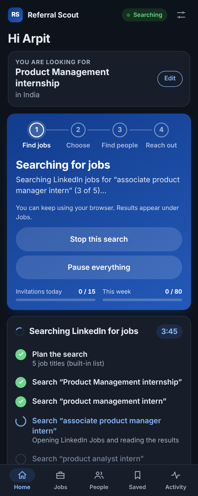

<div align="center">


# Referral Scout

**Find jobs that fit you, apply faster, and get referred.**

A Microsoft Edge extension that searches LinkedIn for jobs that fit your background, finds the people at each company whose referral counts, drafts your messages, and fills job applications for you. It never sends a message or submits an application without you.

**[Get it on Microsoft Edge Add-ons](https://microsoftedge.microsoft.com/addons/detail/referral-scout-jobs-and-/lhfibhgokebhefdagadklckepkbbljhc)**

</div>

<p align="center">
  
  &nbsp;
  
  &nbsp;
  
</p>

## What it does

- **Finds jobs that fit you.** Searches LinkedIn for your target role and similar titles, then ranks the results against your profile and CV.
- **Finds who can refer you.** At each company you pick: people you already know, alumni of your school, recruiters, and the team you would join.
- **Writes your messages.** Personal connection notes and follow-ups, each waiting for your approval.
- **Fills applications.** LinkedIn Easy Apply and company career sites, every step, with your CV attached. It stops at the final review: you press Submit.
- **Keeps track.** Who accepted, who replied, who said they will refer you, and every application you sent.

## Get started

1. **Install** from [Edge Add-ons](https://microsoftedge.microsoft.com/addons/detail/referral-scout-jobs-and-/lhfibhgokebhefdagadklckepkbbljhc) and click the Referral Scout icon to open the side panel.
2. **Sign in** to LinkedIn and to [chatgpt.com](https://chatgpt.com) in the same browser. Referral Scout uses your own ChatGPT account to rank jobs and write.
3. **Read your profile.** The panel reads your LinkedIn profile. Upload your CV in Settings for better messages and applications.
4. **Say what you want**, for example "product management intern", and press **Find jobs and referrals**.
5. **Tick the companies** worth going after. Nothing is sent to anyone before you choose.
6. **Approve** the messages under **Needs you**. A number on the toolbar icon tells you when something is waiting.

### Applying for a job

Open any job on LinkedIn or on a company's careers site and press **Fill this application** in the panel. Referral Scout fills every step, adds entries such as your education and work history, and attaches your CV. It asks you only what it can't know, such as salary or notice period, and remembers the answer. When you have submitted, it can start looking for people at that company who can refer you.

It never types passwords, never answers diversity questions for you, and never presses Submit.

## Your account stays safe

LinkedIn does not allow automated activity, so Referral Scout works slowly, the way a careful person would. Use it at your own risk.

| | Default |
|---|---|
| Invitations | 30 a day, 80 a week |
| Pause between sends | 30 seconds or more, never a fixed rhythm |
| People per company | 3 |
| Approval | Every message waits for you (automatic sending is optional) |

**Pause everything** stops all activity at once. If LinkedIn signs you out or shows a security check, Referral Scout pauses and tells you why.

## Your data

- Everything (your profile, CV, jobs, people, messages and answers) is stored in your browser, on your device.
- Prompts go to your own ChatGPT account and follow your ChatGPT history settings.
- With your agreement on the first screen, one usage record per LinkedIn account is sent so we can count users: a random install ID, your name, your LinkedIn profile ID and when you first used it. Nothing else is collected, sold or used for ads.
- **Settings → Export saved data** downloads everything. **Delete everything** removes it.

Full privacy policy: https://referral-scout.vercel.app/privacy

## If something goes wrong

| What you see | What to do |
|---|---|
| ChatGPT is not responding | Sign in at chatgpt.com in the same browser, then press **Test ChatGPT** in Settings. |
| Buttons are missing on LinkedIn | Refresh the LinkedIn tab after installing or updating. |
| Nothing seems to happen | Open **Activity**: the newest line says what Referral Scout is waiting for. |
| A page is read wrongly | Open the page and press **Check this LinkedIn page** in Activity. |

## For developers

TypeScript, Manifest V3, Vite, Zod and Vitest. With Node.js 22+:

```bash
corepack pnpm install --frozen-lockfile
corepack pnpm build    # outputs dist/ (load it in edge://extensions with "Load unpacked")
corepack pnpm check    # formatting, tests, types and build
```

See [CONTRIBUTING.md](CONTRIBUTING.md), [CHANGELOG.md](CHANGELOG.md) and [SECURITY.md](SECURITY.md).

## License

All rights reserved. Please ask before reusing or redistributing the code.
