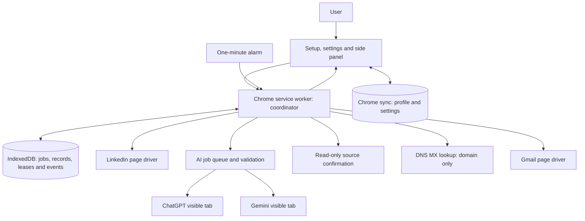

# Cold Contact Pro

**A Chrome extension being built to make thoughtful internship outreach easier—without API keys, coding, or a separate server.**

Finding relevant companies, finding the right person, checking their contact details,
and writing a useful email takes time. Cold Contact Pro aims to handle that research
and routine follow-up, while keeping the user in control of their profile, messages,
and real conversations.

> **Current status: guarded preview, not a live-browser-certified outreach product.**
> Guided CV setup, editable profiles, settings, diagnostics, campaign controls, and
> a complete no-website mock campaign are implemented. CV extraction and live website
> automation still need verification in the user's own sessions. Live sending remains
> gated behind health checks, ten real Gmail drafts, explicit approval, and recovery
> safeguards.

[First-time setup](docs/setup.md) · [Implementation status](docs/implementation-status.md) · [Contributing](CONTRIBUTING.md) · [Security](SECURITY.md)

## Who this is for

The intended user is a student or career changer who can use Chrome and Gmail but
may never have created an API key, configured an AI model, or run a command in a
terminal. Everyday use should feel like completing a short profile and reviewing
emails, not operating a developer tool.

The extension is designed for **any user**, not for one person's CV or account.
Names, qualifications, work history, email addresses, resume links, and preferences
belong in editable settings—not in source code or public fixtures.

The initial campaign scope is India-based AI and technology startups with 11–500
employees, with a focus on Product Management internships and related roles such
as APM, Product Analyst, Product Ops, and product-facing business/growth work.
Profiles and target preferences are editable; broader discovery coverage will need
its own implementation and testing.

## What we want to achieve

1. **Make setup easy.** Start with a CV, extract useful facts, and ask only for
   missing details and preferences. Keep manual entry available.
2. **Research before reaching out.** Find suitable companies, check their activity,
   identify relevant India-based contacts, and record where an email was found.
3. **Write specific, truthful emails.** Use the person's actual experience and a
   sourced company fact. Never invent achievements or claim an unverified vacancy.
4. **Reduce repetitive work.** After review and approval, schedule messages, track
   replies and bounces, and manage limited follow-ups.
5. **Keep control visible.** Explain what is happening, provide Pause and Stop,
   and stop for uncertainty or account warnings instead of trying to bypass them.

This is not intended to be a bulk-email blaster. It will not automatically send
LinkedIn connection requests or InMail, reply to real conversations, solve CAPTCHAs,
or guarantee that someone will respond or offer an internship.

## Why there are no AI API keys

An API is a separate way for software to access a service. Setting one up can mean
creating credentials, arranging billing, choosing models, and managing usage limits.
We do not want that to be a requirement for an ordinary user.

Instead, the extension uses **the websites the user already knows and is logged into**:

| Task | Preferred website | Why |
| --- | --- | --- |
| Read the user's CV | ChatGPT | Extract facts for an editable profile |
| Draft emails and follow-ups | ChatGPT first | Follow the user's writing style and relevant experience |
| Research companies, public business contacts, and roles | Gemini first | Use web research with source URLs |
| Discover companies and people | LinkedIn | Read information rendered on the page |
| Save drafts, send approved outreach, and check replies | Gmail | Work through the user's existing mailbox interface |

For campaign AI jobs, the intended fallback is one attempt on the other provider
when appropriate. **CV setup does not silently share a CV with another provider.**
The user explicitly agrees before their CV is submitted to ChatGPT.

There is no extension-owned server, analytics service, remote executable code, or
LLM API integration. The extension never asks for or extracts passwords, cookies,
or authentication tokens. Login remains the user's responsibility on each website.

**The trade-off:** website layouts, account features, and usage limits can change.
Working through a visible page is less predictable than a supported API. We accept
that limitation and design for checks, recovery, and manual intervention. No API
key is required, but free or unlimited access to the underlying services is not
promised, and account restrictions are not bypassed.

## The experience we are building

### 1. Set up once, edit anytime

- Upload a PDF, DOCX, or TXT CV under 5 MB; paste its text; or try a public file link.
- Read the sharing notice and choose whether to have ChatGPT extract the details.
- Review the proposed name, contact email, education, and evidence-backed work examples.
- Confirm the actual Gmail sending address, target roles, availability, preferred
  locations, resume link, and writing style. Details absent from the CV are not guessed.
- Save the profile. Everything remains editable; users can also skip AI extraction
  and complete the form manually.

A resume upload and a public resume link serve different purposes: the upload helps
with extraction; the public link is what an outreach email will contain. If a Google
Drive link returns a preview or login page rather than a downloadable file, the setup
flow asks the user to upload the downloaded CV instead. Users must check that their
outgoing resume link is accessible to recipients.

### 2. Try drafts before enabling sending

Every campaign starts in **Dry run**. The completed pipeline will prepare messages
in Gmail Drafts without sending them. After ten drafts, it will pause for review.
Only the user can choose **Approve and switch to Autopilot**. The extension must
never switch itself into that mode, and mock results must never count as approval.

### 3. Run a campaign with clear controls

Once approved, the intended workflow is:

**Discover companies → vet them → choose a contact → confirm an email → check roles
→ write and validate a draft → schedule sending → monitor replies and bounces.**

If no usable email is found, mark the contact **Needs LinkedIn outreach** and skip
automatic sending. If a role is only suggested, the email must enquire about possible
openings rather than pretend the company advertised that role.

The side panel will show progress, draft previews, today's send allowance, recent
activity, provider problems, and items needing help. Users should not need to read
debug logs to understand the next action. Real replies belong to the user; the
extension will notify them and stop follow-ups for that contact.

## Current implementation versus planned features

| Area | Status |
| --- | --- |
| Generic guided setup and editable profile | Included in the build |
| CV upload, public-link download, pasted text, consent and review | Included; live ChatGPT compatibility still needs verification |
| Profile import, settings, storage, validation and read-only diagnostics | Included |
| Website parsers, provider bridge and pipeline modules | Integrated; live selectors still need user-session verification |
| Start/Pause/Resume/Stop campaign dashboard and recovery | Included; mock and recovery paths are tested |
| Ten-draft approval and live campaign sending | Guarded in code; requires live-browser verification |
| Reply/bounce monitoring and follow-up scheduling | Implemented with bounded checks; live Gmail pagination needs verification |
| Campaign retention, Delete All Data, and send-log export | Included; Gmail/AI provider history is outside extension deletion |

See [implementation-status.md](docs/implementation-status.md) for specific outstanding
work. Passing unit tests is not evidence that live website automation works.

## Architecture and design decisions

This section describes the **intended complete architecture**. Only the setup and
diagnostic paths are currently connected in the installed build.



| Component | Responsibility and design rule |
| --- | --- |
| Manifest V3 service worker | Coordinate work and control tabs. No server or offscreen orchestration. |
| Alarm and lease | One tick per minute, one eligible step per tick, with a persistent lease refreshed every 20 seconds to prevent overlap. |
| IndexedDB | Durable company, person, email, role, draft, send and event records; jobs, schedules and recovery metadata. Progress must survive worker shutdown. |
| Chrome sync | Editable profile and preferences. Chrome may sync these through the user's browser account. |
| Content scripts | Read rendered pages and perform narrowly defined interactions on LinkedIn, Gmail, Gemini and ChatGPT. No private service APIs. |
| AI bridge | FIFO queue, provider preference, bounded waits, schema checks, one repair, controlled fallback and circuit breakers. |
| Source confirmation | With user-granted HTTPS access, open the cited page and confirm the literal address or mailto link. No persistent script on arbitrary websites. |
| Visible windows | A dedicated automation window and provider windows kept unminimized; background throttling can interrupt streaming. |
| Validators | Treat scraped pages and model replies as untrusted. Accept bounded, typed data; render text rather than HTML. |
| Recovery | Record intent before actions. Reconcile an uncertain send before any retry; a missing success signal must not cause duplicate mail. |

The implementation uses strict TypeScript, Vite, Zod schemas, IndexedDB, and Vitest.
Selectors live in one configuration file with fallbacks. Website messages must have
validated senders, request IDs and deadlines. Content-script heartbeats help during
long waits, but persistent state—not keeping a worker alive—is the recovery strategy.
Offscreen documents, if needed, are reserved for DOM parsing.

## Outreach safeguards required before release

These are release requirements, not claims that the current preview enforces a full campaign:

- **Contact evidence:** prefer first-degree LinkedIn contact information, published
  business emails, or published recruiting addresses. Record the source, evidence,
  and confirmation result. An MX record checks mail infrastructure, not whether a
  particular mailbox exists or whether outreach is welcome.
- **Pattern inference:** off by default; only a sourced pattern may be considered,
  capped at three per day and disabled after any bounce from that method.
- **Conservative volume:** Monday–Friday, 10:00–17:30 Asia/Kolkata by default, with
  optional holidays. Sending-day ramp: 5/day for days 1–3, 10/day for 4–7, 15/day for
  8–14, then 20/day; hard maximum 25. Follow-ups also consume the daily allowance.
- **Limited contact frequency:** prefer one contact per company; no new initial
  email to the same company domain within 14 days. Respect opt-outs and prior contacts.
- **Bounded browsing:** separate LinkedIn search/profile budgets, randomized pacing,
  breaks, and backoff. Budget exhaustion means waiting, not bypassing limits.
- **Truthful drafts:** fewer than 120 words, one relevant proof point, one clear ask,
  one resume link, and no unsupported claims. Follow-ups stay under 60 words and add
  no links. Draft checks also reject excessive similarity to recently sent messages.
- **Stop on replies:** real replies cancel follow-ups. Automatic replies postpone
  them. Follow-ups are limited to sending days 5 and 12; there is no automatic reply
  to a real conversation. Quoted text must not be mistaken for an opt-out.
- **Pause on danger or uncertainty:** CAPTCHA, checkpoint, unusual activity,
  sending limits, critical selector failure, wrong sender, signed-out sessions,
  repeated provider failures, or excessive bounces. Resume is manual and requires checks.
- **Opt-out line:** every outreach message includes: “If this isn't relevant,
  reply 'no thanks' and I won't write again.”

## Privacy, permissions, and practical limits

**Local coordination does not mean data never leaves the computer.** CVs explicitly
submitted for extraction go to ChatGPT. Planned drafting/research prompts can include
the user's profile, recipient names, and company information and go to ChatGPT or
Gemini through their websites. Email domains go to `dns.google` for planned MX checks.
Gmail handles draft and message storage. Each service has its own privacy policies.

In CV setup, the extension removes its temporary uploaded/text input after success,
failure or cancellation. Extracted candidates are cleared on save/cancel; stale
imports are checked on startup after a day. This cannot recall a CV already submitted
to ChatGPT or delete the service's copy. Saved profile/settings use Chrome sync;
operational records use local IndexedDB.

Optional HTTPS access is requested through a user action for public CV downloads
or future source confirmation. Granting it does not authorize sending or enable
Autopilot. Without source-confirmation access, the planned campaign must stay in
Dry run. Some declared permissions are reserved for unfinished features.

Names and person-linked business emails should be handled as personal data. The
project requires evidence records, opt-out handling, and data minimization as design
policy; it does not claim those measures alone establish legal compliance. India's
[Digital Personal Data Protection Act](https://www.meity.gov.in/static/uploads/2024/02/Digital-Personal-Data-Protection-Act-2023.pdf)
is relevant context; public availability must not be treated as blanket permission
for any use. Planned retention is 90 days for skipped/bounced contact records and
180 days overall, alongside export and Delete All Data controls. These campaign
retention/deletion controls are not yet complete.

Automated access may breach LinkedIn, Google, or OpenAI terms and lead to account
restrictions. Users must understand and accept that risk before live use. The
extension cannot promise deliverability, account safety, or uninterrupted operation.
Chrome must stay open, the computer awake, and automation windows visible.

## Try the current preview

There is no finished Chrome Web Store release or ready-made public installer yet.
The preview currently requires building the source once. A nontechnical user may
want help with this developer setup; the intended everyday workflow requires no
terminal, server management, or API keys.

With Node.js 24 and npm installed, run these commands from the project folder:

```sh
npm install --global pnpm@11.25.0
pnpm install --frozen-lockfile --ignore-scripts
pnpm check
```

Then open `chrome://extensions`, turn on **Developer mode**, choose **Load unpacked**,
and select the generated `dist` folder. Pin the extension, click its icon, and choose
**Set up from my CV**. Reload existing website tabs after installing or updating.
Log into the websites yourself; never enter their passwords into extension settings.

For subsequent builds, use `pnpm build`, then Reload the extension in Chrome.
Follow [the setup guide](docs/setup.md) to test CV extraction and editing.
Use Mock mode first to exercise the full campaign without opening websites. Do not treat
passing mock tests as proof that live website selectors or account behavior work.

## Development, verification, and contribution

```sh
pnpm test          # Vitest validators, parsers, fixtures, storage and setup recovery
pnpm test:spike    # Standalone feasibility-probe parser tests
pnpm typecheck    # Strict TypeScript
pnpm build        # Type-check, Vite bundles and MV3 output checks
pnpm check        # Full local check
```

Dependencies are pinned in `package.json` and `pnpm-lock.yaml`. GitHub Actions runs
the complete check without logging into websites or sending messages. Fixtures are
synthetic; see [how to refresh them safely](fixtures/README.md). Before enabling
Autopilot, require end-to-end dry-run tests, restart/pause recovery tests, duplicate
send prevention, evidence checks, and live verification of every relevant site.

Main source areas are `src/background` (coordination), `src/bridge` (AI jobs),
`src/content` (website interaction), `src/pipeline` (campaign stages), `src/storage`,
`src/shared`, `src/parsers`, `src/validators`, and `src/ui`. Tests live in `tests/`;
the original browser feasibility probes live in `spike/`.

Contributions should explain what changed, why, and how it was verified, and include
a suggested commit title and description. Keep public documentation honest about
implemented versus planned behavior. Never commit real CVs, profiles, mailbox
captures, campaign exports, or secrets. Generated builds and private local files
are ignored, but ignore rules do not remove data already tracked by Git.

Read [CONTRIBUTING.md](CONTRIBUTING.md) before changing code and [SECURITY.md](SECURITY.md)
for private vulnerability reporting. No redistribution license has been selected;
this repository is not currently offered under an open-source license.
