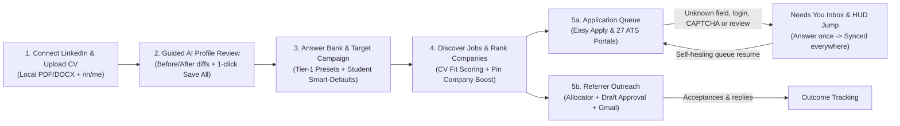
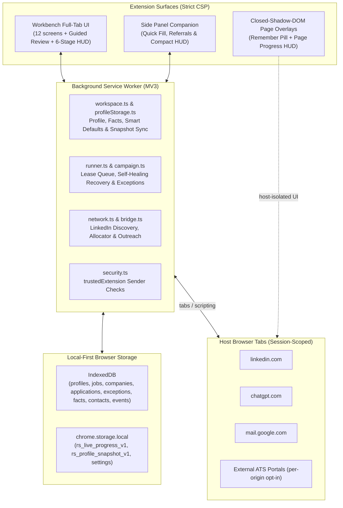

<div align="center">


# Referral Scout

**Local-first Chrome & Edge assistant for CV-ranked job discovery, company prioritization, warm referrer outreach, and human-in-the-loop application autofill.**

[](manifest.json)
[](CHANGELOG.md)
[](#verification--packaging)
[](SECURITY.md)

**[Microsoft Edge Add-ons](https://microsoftedge.microsoft.com/addons/detail/referral-scout-jobs-and-/lhfibhgokebhefdagadklckepkbbljhc)** · **[Architecture](docs/architecture.md)** · **[Development Guide](docs/development.md)** · **[Privacy Policy](docs/privacy.md)** · **[Chrome & Edge Store Packet](docs/store-submission-chrome-edge.md)**

</div>

<p align="center">
  
  &nbsp;
  
  &nbsp;
  
</p>

---

## Key Capabilities

- **Smart CV & LinkedIn Reconciliation:** Parses PDF/DOCX resumes locally, compares your CV against your signed-in LinkedIn profile through ChatGPT, surfaces Before/After conflict diffs with 1-click **"Looks Good — Save All"** confirmation, and hydrates your Candidate Profile and Answer Bank atomically (`profileStorage.ts`).
- **3-Tier Student-Friendly Answer Bank & Just-in-Time Learning:** Organizes questions into **Tier 1 Core Essentials** (1-click pill presets for authorization, availability, start date, relocation), **Tier 2 Role Preferences**, and a collapsible **Tier 3 Auto-Learned Accordion**. Detects **Student / Intern** profiles automatically to offer 1-click safe smart defaults (`Immediate`, `N/A (Student)` CTC).
- **6-Stage Floating Progress HUD:** Cross-context persistent bottom HUD (`chrome.storage.local` + Closed-Shadow-DOM host overlays) that guides you cleanly across setup, CV review, campaign creation, LinkedIn job search, **Needs You** approvals, and active queue progress.
- **Opportunity-Centred Workspace & Today's Priorities:** Unified 6-tab **Opportunity Workspace** (`Overview`, `Application`, `People`, `Conversations`, `Timeline`, `Outcome`) per vacancy with pre-flight application readiness checks, multi-role contact collision prevention, and a ranked **Today's Priorities** action feed.
- **Company Ranking, Cross-Channel Conversations & Pin Priority:** Discovers LinkedIn roles, qualifies eligibility against your real profile, ranks target companies transparently (`rankCompanies()`), tracks LinkedIn + Gmail replies per opportunity, and supports 1-click **Pin company** boosts.
- **Human-in-the-Loop Application Queue & Referrer Outreach:** Runs a lease-backed queue across LinkedIn Easy Apply and **27 ATS platforms** (Greenhouse, Lever, Workday, Ashby, Workable, Recruitee, Teamtailor, Naukri, Instahyre, Wellfound, Zoho Recruit, Keka, Darwinbox, and more). Automatically pauses in **Needs You** for logins, CAPTCHAs, unfamiliar questions, uncertain submissions, or final review—while healthy applications continue.

---

## End-to-End User Workflow



---

## Manifest V3 Extension Architecture



---

## Repository Structure

```text
.
├── manifest.json                 # Chrome & Edge MV3 extension manifest (v0.58.2)
├── package.json                  # Dependencies, scripts (check, test, build, package)
├── install/                      # Unpacked installer scripts (macOS & Windows)
├── public/icons/                 # Extension icons (16, 32, 48, 128 PNG)
├── scripts/
│   ├── check-build.mjs           # Automated MV3 bundle, CSP, version & asset validator
│   └── package-extension.mjs     # Builds deterministic store-ready referral-scout.zip
├── src/
│   ├── background/               # Service worker, runner, campaign, workspace, network, gmail
│   ├── connectors/job-sources/   # Source adapter contract & normalizers
│   ├── content/                  # Host-page scripts (apply.ts, network.ts, shadow-DOM HUD)
│   ├── shared/                   # Domain models, state machines, allocator, progress-store
│   └── ui/                       # Workbench (12 screens) & Side Panel components
├── tests/                        # 43 Vitest test files (713 unit & integration tests)
└── docs/
    ├── architecture.md           # Deep technical architecture & schemas
    ├── development.md            # Dev setup, testing, selectors & release checklist
    ├── privacy.md                # Store-compliant privacy policy
    ├── store-submission.md       # Chrome Web Store & Edge Add-ons review packet
    └── screenshots/              # Store preview screenshots
```

---

## Quickstart

### Install & Build Unpacked (`Chrome` & `Edge`)

Requires **Node.js 22+** and **pnpm 11.25.0**:

```bash
corepack pnpm install --frozen-lockfile --ignore-scripts
corepack pnpm build
```

Load the generated `dist/` folder in `chrome://extensions` or `edge://extensions` (**Developer mode** → **Load unpacked**).

### Unpacked Release Installers

- **Windows (PowerShell):** `powershell -ExecutionPolicy Bypass -File install/install-windows.ps1`
- **macOS (Bash):** `bash install/install-mac.sh`

---

## Verification & Packaging

```bash
pnpm format:check   # Prettier style check (src, tests, scripts)
pnpm typecheck      # Strict TypeScript check
pnpm test           # 43 suites, 713 tests (Vitest + JSDOM + fake-indexeddb)
pnpm check          # Full CI gate: format + vitest + tsc + vite builds + check-build.mjs
pnpm package        # Builds & verifies referral-scout.zip with SHA-256 hash
```

---

## Privacy & Safety Guarantees

- **Zero External Account Required:** CVs, profile data, jobs, contacts, and application logs stay locally in your browser.
- **No Credential Capture:** Operates inside your own signed-in tabs; passwords and session cookies are never collected or stored.
- **Opt-In Usage Counting Off by Default:** Never enabled automatically; even when opted in manually in Settings, transmits only an anonymous install UUID, display name, and LinkedIn handle (never CVs, emails, jobs, or messages).

See [PRIVACY POLICY](docs/privacy.md), [SECURITY.md](SECURITY.md), [CONTRIBUTING.md](CONTRIBUTING.md), and [CHANGELOG.md](CHANGELOG.md).

## License

All rights reserved. Contact the maintainer before reusing or redistributing source code.
