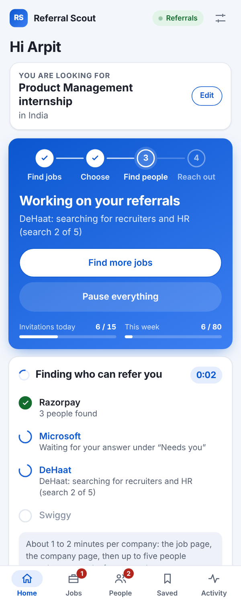

<div align="center">


# Referral Scout

**Find jobs that fit you, apply faster, and get referred.**

A Microsoft Edge extension that searches LinkedIn for jobs that fit your background, finds the people at each company whose referral counts, drafts your messages, and helps complete job applications. By default, it pauses for your review; optional automation settings can send or submit only when you explicitly enable them.

**[Get it on Microsoft Edge Add-ons](https://microsoftedge.microsoft.com/addons/detail/referral-scout-jobs-and-/lhfibhgokebhefdagadklckepkbbljhc)**

</div>

<p align="center">
  
  &nbsp;
  
  &nbsp;
  
</p>

## What it does

- **Finds jobs that fit you.** Searches LinkedIn for your target role and similar titles, then ranks the results against your profile and CV.
- **Finds who can refer you.** At each company you pick: people you already know, alumni of your school, recruiters, and the team you would join.
- **Writes your messages.** Personal connection notes and follow-ups, each waiting for your approval.
- **Fills applications.** LinkedIn Easy Apply and company career sites, every step, with your CV attached. It stops at the final review: you press Submit.
- **Keeps track.** Who accepted, who replied, who said they will refer you, and every application you sent.

## Get started

1. **Install** from [Edge Add-ons](https://microsoftedge.microsoft.com/addons/detail/referral-scout-jobs-and-/lhfibhgokebhefdagadklckepkbbljhc) and click the Referral Scout toolbar icon. A compact side panel opens first and gives you one clear next step: open the setup dashboard.
2. **Sign in to LinkedIn** from the dashboard. The sign-in happens on LinkedIn itself; then choose **Read my LinkedIn profile**. Referral Scout never asks for or stores your LinkedIn password. Profile reading works whether usage reporting is enabled or not.
3. **Add your CV** from **Candidate profile**. Upload a PDF or DOCX. The file and LinkedIn capture remain separate source evidence; neither is copied directly into your candidate profile.
4. **Ask ChatGPT to reconcile both sources.** Referral Scout uses your existing signed-in ChatGPT website session by default (no API key required). The CV is authoritative when details disagree; conflicts are surfaced in the draft. Review the proposed education, roles, projects and skills, then explicitly approve before suggestions are added to your profile.
5. **Set your search goal** in the guided setup: target role, location and employment type. Create your campaign when you're ready. The role and location are also synced to the side-panel referral workflow.
6. **Connect optional services** only when useful. Open ChatGPT and sign in for browser-based AI assistance; connect Gmail only if you want email drafts and reply tracking. An OpenAI API key is an optional alternative to the ChatGPT website.
7. **Work from the dashboard.** Review jobs, applications, referrals, people and activity there. The side panel remains available as a quick control surface beside LinkedIn.

### First-run privacy choice

Usage counting is optional and off by default. It is not required to read your profile, create a campaign or use core features. If enabled, one usage report sends a random install ID, your display name and LinkedIn profile handle to the developer. It does not include your CV, jobs, contacts or messages. Change this choice at any time in **Settings → Privacy and usage reporting**.

### Applying for a job

Open any job on LinkedIn or on a company's careers site and press **Fill this application** in the panel. Referral Scout fills every step, adds entries such as your education and work history, and attaches your CV. It asks you only what it can't know, such as salary or notice period, and remembers the answer. When you have submitted, it can start looking for people at that company who can refer you.

It never types passwords or answers diversity questions for you. With the default review policy, it leaves the final Submit action to you; automatic submission is a separate campaign setting that you must explicitly choose.

## Your account stays safe

LinkedIn does not allow automated activity, so Referral Scout works slowly, the way a careful person would. Use it at your own risk.

| | Default |
|---|---|
| Invitations | 30 a day, 80 a week |
| Pause between sends | 30 seconds or more, never a fixed rhythm |
| People per company | 3 |
| Approval | Every message waits for you by default (automatic sending is optional) |

**Pause everything** stops all activity at once. If LinkedIn signs you out or shows a security check, Referral Scout pauses and tells you why.

## Your data

- Candidate profile, CV, jobs, contacts, messages and application records are stored locally in your browser.
- AI-assisted tasks send the relevant context to your own signed-in ChatGPT session, or to OpenAI if you configure an API key. API usage is billed by OpenAI.
- Usage counting is a separate opt-in. The report contains only a random install ID, display name and LinkedIn profile handle; it excludes CV, jobs, contacts and messages.
- **Settings → Export a backup** downloads a local copy. OpenAI API keys are deliberately excluded from exports.

Full privacy policy: https://referral-scout.vercel.app/privacy

## If something goes wrong

| What you see | What to do |
|---|---|
| ChatGPT is not responding | Sign in at chatgpt.com in the same browser, then press **Test ChatGPT** in Settings. |
| Buttons are missing on LinkedIn | Refresh the LinkedIn tab after installing or updating. |
| Nothing seems to happen | Open **Activity**: the newest line says what Referral Scout is waiting for. |
| A page is read wrongly | Open the page and press **Check this LinkedIn page** in Activity. |

## For developers

TypeScript, Manifest V3, Vite, Zod and Vitest. With Node.js 22+:

```bash
corepack pnpm install --frozen-lockfile
corepack pnpm build    # outputs dist/ (load it in edge://extensions with "Load unpacked")
corepack pnpm check    # formatting, tests, types and build
```

See [CONTRIBUTING.md](CONTRIBUTING.md), [CHANGELOG.md](CHANGELOG.md) and [SECURITY.md](SECURITY.md).

## License

All rights reserved. Please ask before reusing or redistributing the code.
