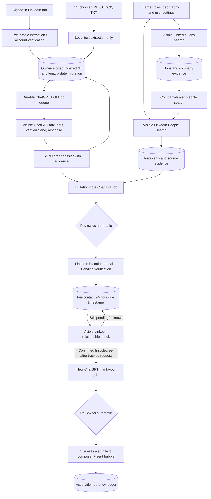

# Cold Contact Pro v0.6.2 — implementation and validation handoff

**Date:** 6 November 2026  
**Basis:** `Cold_Contact_Pro_Master_Fix_Prompt_v2(1).md`, the supplied `cold-contact-pro-main(1).zip`, and the supplied `website.zip` saved page assets.  
**Delivery class:** Edited source code and reproducible build instructions; **not an installed, live-verified production extension**.

## Executive result

The existing repository was **patched in place**, not replaced with an unrelated project. The P0 ChatGPT DOM task code was rewritten around persistent job markers, page/document handshakes, ordered prompt chunks, send verification and a distinct assistant-turn response. Jobs and company-linked People discovery were added; the invitation path now attempts personalized notes; CV binaries and LinkedIn message attachments were removed from the new workflow; 24-hour per-contact checks, optional approval/automatic modes, and an enhanced side panel were implemented.

**The critical acceptance criterion remains outstanding:** A real signed-in Edge/LinkedIn/ChatGPT end-to-end rehearsal and a production dependency-backed build were **NOT RUN**. The supplied saved ChatGPT page did not include a real composer or conversation turns, and only static LinkedIn assets were available. No prompt submission, invite, acceptance or sent message is claimed to have occurred.

## File-level change overview

| Priority | Original source symptom / design gap | Modified source and intended behavior | Evidence / caveat |
|---|---|---|---|
| P0 | ChatGPT tab opened with no prompt and in-memory job Map did not survive hydration | `src/content/network-ai.ts`, `src/background/network-ai.ts`, `src/background/service-worker.ts`: worker-backed SHA256 job IDs, document handshake, stable editor, ordered chunk ACK, exact inserted-text verification, visible Send, marked user turn, following assistant turn, stage ledger, in-conversation schema repair | Source inspection and relaxed TypeScript pass; actual Edge composer not observed. **Cause of original live symptom not reproduced.** |
| P0 | Candidate dossier could be confused with a file upload or an owner-profile import | `src/background/network-messages.ts`, `src/background/network-ai.ts`, `src/shared/dossier.ts`: explicit Process action, owner-gated dossier, complete LinkedIn/CV *text* payload, evidence-bound v2 schema | CV and prompt source checked; live transmission not demonstrated |
| P0 | Invitation had a forced “Send without a note” branch | `src/content/network.ts`, `src/background/network-ai.ts`: separate invitation JSON, Add a note, editor/length checking, Pending confirmation; do not silently send when note policy requires it | LinkedIn modal DOM not tested; one-click LinkedIn Connect variants may directly send, requiring manual inspection |
| P1 | Only LinkedIn People discovery | `src/parsers/network.ts`, `src/background/network.ts`, `src/shared/network.ts`: Jobs cards/detail, deduplication, company-linked People searches, standalone People search and role/function prioritization | Static parser review only; exact LinkedIn layout may differ; job ranking is heuristic |
| P1 | Hard-coded extension caps and little user control | `src/shared/network.ts`, `src/ui/sidepanel.ts`: configurable daily thresholds/pacing, Jobs/People mode, multiple roles, approval or automatic mode | Source checks; site-enforced restrictions still stop the workflow |
| P1 | Pending requests lost or confused with acceptance after MV3 restarts | `src/background/network.ts`, `src/background/service-worker.ts`: `requestedAt`, `checkedAt`, `nextCheckAt`, one-minute alarm to select **due** records, uncertain-state quarantine | Worker startup wiring checked; real 24-hour lifecycle not observed |
| P1 | Message flow attempted to attach CV and could conflate acceptance with existing connections | `src/content/network.ts`, `src/background/network.ts`: text-only, exact recipient and sent-bubble check; distinguish pre-existing chats/connections | DOM selectors still need live rehearsal |
| P2 | One opaque old state object, incomplete privacy language | `src/storage/database.ts`, `src/background/network.ts`, `src/ui/sidepanel.ts`, `docs/privacy.md`: v2 object stores and owner-keyed mirrors, activity/diagnostics, delete/export, updated explanation | This is an incremental mirror migration, **not** a complete independent normalized state rewrite; legacy state remains |
| P2 | Version drift and stale documentation | `package.json`, `manifest.json`, `README.md`, `docs/privacy.md`: unified v0.6.0, build/setup instructions | Compiled `dist/` not generated in current environment |

## Architecture / data flow

Source and AI prompt text are stored locally to support retry, but routine status/diagnostic responses avoid raw CV contents. ChatGPT-visible text transmission is intentional, not a hidden API. Ordinary LinkedIn UI submission is what performs any external action.

## Validation results

| Verification | Result | Notes |
|---|---|---|
| Source tree TypeScript parse | **PASS** | Local global TypeScript parser: zero syntax diagnostics across `src/**/*.ts` and `tests/**/*.ts` |
| Relaxed TypeScript semantic check | **PASS WITH LIMITATION** | Zero reported errors using temporary external dependency/type stubs; does **not** replace the project `tsc --noEmit` with real package typings |
| `node --test spike/parsers.test.cjs` | **PASS** | 7 original parser smoke tests passed; these tests do not prove the new LinkedIn/ChatGPT DOM flows |
| Source contract checks (`node --test tests/v2-source-contract.test.mjs`) | **PASS** | 9 static structural assertions; not live browser tests |
| `pnpm install --frozen-lockfile` | **BLOCKED** | npm registry/DNS unreachable in task environment; cannot fetch dependencies |
| Full `pnpm test`, `pnpm typecheck`, `pnpm build`, `pnpm package` | **NOT RUN** | Require actual `node_modules`; Node runtime here v22, repository specifies Node >=24 |
| MV3 built `dist/` and Edge installation | **NOT RUN** | Neither a compiled `dist/` nor a production distributable ZIP is claimed |
| Saved `website.zip` static analysis | **INSPECTED ONLY** | ChatGPT HTML lacked an actual `#prompt-textarea`, user/assistant turns and Send button; saved LinkedIn material was not a usable live Jobs/People page |
| Live signed-in ChatGPT user-turn/response trace | **NOT RUN** | Requires browser access and signed-in session |
| Live LinkedIn job, invite, acceptance and message trace | **NOT RUN** | Requires browser access; no invitations or messages were sent |

**Combined local evidence:** `docs/source-validation-log-v2.txt` records **16/16 Node tests passing** (7 original parser smoke tests, 9 new source-contract checks) and the limitations of the relaxed semantic check.

## Risks remaining before production

1. **P0 browser adapter proof:** ChatGPT may replace the composer or response layout, expose subscription controls differently, or reject synthetic input. Use Chrome/Edge Developer Tools and task-stage traces to identify the exact failure. The saved HTML snapshot is not a substitute for real tests.
2. **P0 send safety:** Some LinkedIn Connect controls can send directly without a note dialog; the code detects Pending and halts note-required runs, but that already may have sent an invitation. Test modal variants on a non-sending rehearsal before automatic mode. The follow-up composer and sent-bubble selector also require live verification.
3. **P0 pause correctness under asynchronous navigation:** Tests must cover service-worker suspension, tab close, account changes, and uncertain request completion. Never auto-retry `uncertain` sends. Some states may require exporting data/manual intervention to resume.
4. **P1 job capture/association:** Search and page-result parsers depend on live LinkedIn DOM shape; People-to-company matching uses the visible headline as a strict employer proxy and can miss valid employees. Job fit and hiring-contact relevance are heuristic; no job vacancy is guaranteed current.
5. **P1 data migration and privacy:** Legacy `network-v1` remains a compatibility source and new stores are normalized *mirrors*, not fully isolated owner databases. A later migration should move the authoritative state to owner-scoped stores, add transactions/multi-account switching, robust recovery, idempotency constraints, retention controls and additional migration tests.
6. **P1 large source handling:** Ordered ChatGPT prompt chunks are reassembled in the page and then inserted as a single text payload; very large extracted CV/profile text may exceed editor or website limits. No silent truncation is intended, but chunkwise **conversation** continuation for oversized prompts is still needed.
7. **P2 effort selector:** Think/Medium selection is best-effort and only declared verified when visible controls appear to confirm; ChatGPT subscription tiers cannot reliably be detected from DOM. UI may require manual selection.
8. **P2 product distribution:** Browser permissions, external service policies, consent/anti-spam handling, accessibility, security review, and live packaging should be validated before public release. This software does not bypass platform restrictions.

## Exact operator verification procedure

1. Install Node 24+, Corepack and working registry, then run `corepack pnpm install --frozen-lockfile`, `corepack pnpm test`, `corepack pnpm typecheck`, `corepack pnpm build`, `corepack pnpm package`. Capture all outputs and address failures.
2. `edge://extensions` → Developer mode → Load unpacked → select compiled **`dist/`**, not the source directory. Ensure displayed extension version is **0.6.0**. Reload after each build. Refresh LinkedIn/ChatGPT tabs.
3. Sign into the correct owner accounts, import profile. Confirm ChatGPT **does not open**. Add searchable CV; check all pages/sections, preview text and no binary storage.
4. Press Process with ChatGPT. Observe staged completion (`document_ready`, `composer_stable`, `insertion_verified`, `user_turn_verified`, `response_extracted`), full payload in the actual visible composer, response JSON validation and saved dossier. Test no CV and CV versions separately; test login/blank/overlimit/rehydration and manual Think/Medium.
5. With mode **Review before every send**, inspect Jobs and People results, associated company, recruiter, lead and founder relevance; preview note. Do a no-send rehearsal first. Then only with explicit authorization test a real invitation and verify Pending + ledger time.
6. For a legitimately accepted tracked request, verify `acceptedAt` only after an observed first-degree indicator, new ChatGPT thank-you and exact recipient/sent bubble. Validate existing-conversation and duplicate prevention. Check 24-hour overdue recovery after Edge restart.
7. Save redacted screenshots, timestamps and document/job IDs, and record PASSED/FAILED/NOT RUN for each step. Do not elevate this source candidate to production until the P0 live requirements pass.

## Packaging note

The handoff source ZIP contains the full modified repository, tests, scripts, lockfile and this report. It does **not** contain a fake `dist/`, fake installation proof, fake screenshots or alleged sent contacts. A separate unified diff compares the edited source against the originally uploaded source ZIP.

## v0.6.1 patch: "The complete prompt did not survive ChatGPT hydration"

Root causes found by inspecting a saved copy of the live ChatGPT page and by reproducing the failure in a test:

1. The composer is a ProseMirror editor (`.ProseMirror[contenteditable]`, no `#prompt-textarea`, almost no `data-testid` hooks). It re-renders typed newlines as separate `
` paragraphs, and `innerText` reports those as blank lines. The old check compared the editor text to the prompt with strict equality after a single 250 ms wait, so a perfectly inserted prompt was rejected. It now polls up to 8 s and compares whitespace-insensitively (`sameText`), with a letters-and-digits fallback for composer markdown. Nothing is sent unless the complete prompt is present. The error now includes a content-free diagnosis (expected length, editor length, first difference index).
2. A job that failed before Send was stored as permanently `failed`. Every later press of Process replayed the stored error without trying again. A task that never reached Send is now retried in a fresh tab (the stale tab with the unsent draft is closed). A task that may have been submitted is still never retried.
3. Errors containing "changed" or "already" were classified `uncertain` even when Send had never been clicked. `uncertain` now requires that Send was clicked.
4. Send button lookup no longer depends on `data-testid`; it falls back to the composer form's aria-labels and submit button, and reports the visible composer buttons if none is found.

Other fixes: recipient identity can no longer be overwritten by scraped profile data (previously a mismatched profile could redirect a message and hide the error); the LinkedIn note, message and Gmail verifiers use the same whitespace-insensitive comparison; TypeScript is now clean under the project's strict settings; four stale tests were corrected; five regression tests were added (`tests/chatgpt-hydration.test.ts`, `tests/ai-retry.test.ts`).

Not verified: the real ChatGPT Send button, stop button and conversation-turn markup, because the saved page was an empty chat. A live run on Edge is still required (see the verification steps above).

## v0.6.2 patch: "Send result cannot be verified", silent failures, vague feedback

1. ChatGPT had answered, but the extension could not find its own message in the page (it relied on one attribute that this ChatGPT build may not expose), so it stopped as "uncertain" and saved nothing. Detection now also finds the message by its job marker text and reads the reply from the next block that carries JSON. The error now says what it saw (marker on page, turns found by attribute).
2. Even a detected reply would have been rejected: ChatGPT returns `missingInformation` and `conflicts` as `{detail}` objects, while the validator accepted only strings. Both forms are now accepted.
3. An "uncertain" task no longer blocks forever. Before giving up, the extension re-reads the same ChatGPT conversation and takes a finished reply if it is there. It still never resends a prompt that may have been submitted.
4. New recovery box in step 1: recover the reply from the open ChatGPT tab, paste the JSON reply manually, or clear stuck tasks.
5. Notifications: every action now shows a toast (success, error, info). ChatGPT tasks show a live "step n of 11" progress toast. Errors also stay in a banner at the top.

Still not verified against live ChatGPT: the Send/Stop buttons and conversation markup (the saved page was an empty chat).

## v0.7.0: self-audit and product hardening

Found and fixed (each has a regression test):

1. Start was blocked until a ChatGPT dossier existed. The promised flow (read profile, check target and introduction, start) now works with editable templates; ChatGPT personalisation is optional and falls back to the templates on any failure.
2. Jobs-only mode never searched for people, so it could never send anything. It now finds recruiters and leaders at each job's company.
3. "Use a note when available" threw and paused the whole campaign when LinkedIn offered no note field (free accounts run out of notes). It now sends without a note and records that.
4. Targeting was a few loose regexes. New `src/shared/targeting.ts`: rejects students, open-to-work, former roles, assistants and chiefs of staff, "product owner", "lead generation"; accepts Talent Partner, sourcer, campus recruiting, HRBP, Cofounder, Head/Director in the user's function; scores and ranks; limits three people per company; tolerant company matching ("Pvt Ltd").
5. Search: role and contact kind were coupled (3 roles x 3 kinds never combined fully), search never stopped, and 1st-degree people were scraped then wasted. Now a full role x kind grid, boolean queries, a 2nd/3rd-degree filter, a five-page limit with a clear "all searched" message, and degree captured from result cards.
6. Safety defaults were unlimited. Now 15 invitations a day, 80 a week, 100 pending, 3-minute pace with random variation, local quiet hours (8:00 to 22:00), and a maximum of five unreviewed drafts. LinkedIn's weekly-limit dialog is detected and pauses outreach without losing the person.
7. One bad profile paused the entire campaign. Recipient-specific failures now skip that person only.
8. Discovery ran forever even with a full queue; it now waits while 15 or more people are queued, and the status line says why nothing is happening (limits, quiet hours, review queue).
9. Every state change rewrote every contact to IndexedDB; only changed records are written now.
10. Suggested target uses the profile's work history and tags students as internships; default location is the country, not "Pune Division, Maharashtra, India".

Not verified: live LinkedIn page layout, the `network` search filter parameter and boolean queries against real LinkedIn, and the real ChatGPT conversation markup.

## v0.7.1: follow-ups from an independent audit

Done: the search cursor is split (jobs and people have separate counters, so Jobs + People no longer skips half of the people searches); a failing page now only affects that person (retry after 30 minutes, set aside after two failures, and a stop with an explanation after three failures in a row); acceptance checks are spaced 40 to 90 seconds apart; invitations still pending after 30 days stop being tracked with advice to withdraw them; an extension update no longer pauses a running campaign; the LinkedIn window is no longer pulled to the front; model-written text containing links, email addresses or phone numbers is refused (and replaced by the template); finished per-contact ChatGPT tabs are closed; re-reading your own profile keeps your dossier; old action history is pruned; template variants (separated by `---`) so messages are not identical; and a read-only "Check this LinkedIn page" button that reports what the page exposes.

Known gaps: batch acceptance detection from LinkedIn's sent-invitations list (still one profile visit per pending contact per day); automatic reconciliation of an interrupted send; a bulk-approve draft queue; per-entity storage instead of the single state record (stale-copy writes remain possible); removal of the retired Gmail and campaign code (it still ships in health.js); sending less recipient text to ChatGPT; geography as a real filter; and proof against live LinkedIn.

## v0.8.0: side panel redesign

The old panel was functional but poor: unstyled form controls with labels crammed beside boxes, headings numbered out of order, wrapping statistics, no hierarchy, and no visible account of what the extension was doing. It was rebuilt and checked visually in a real browser (screenshots in `docs/screenshots`). A status card now states what is happening in plain words, including quiet hours (previously a likely cause of "Start did nothing"). Setup, People and Activity are tabs; people needing approval or attention sort first; an activity log records every status change; edits are never discarded by the periodic refresh; light and dark themes follow the browser. A 7-test UI suite loads the real panel and clicks through it.

Still unverified: live LinkedIn and ChatGPT pages.
